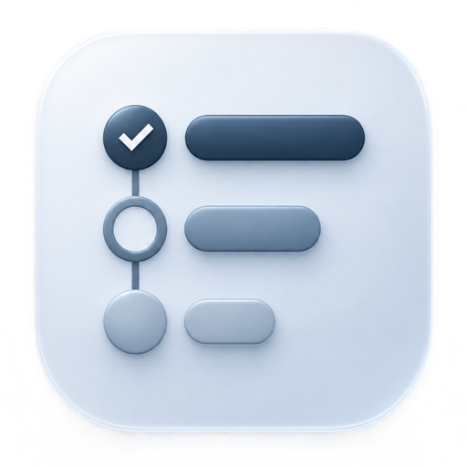
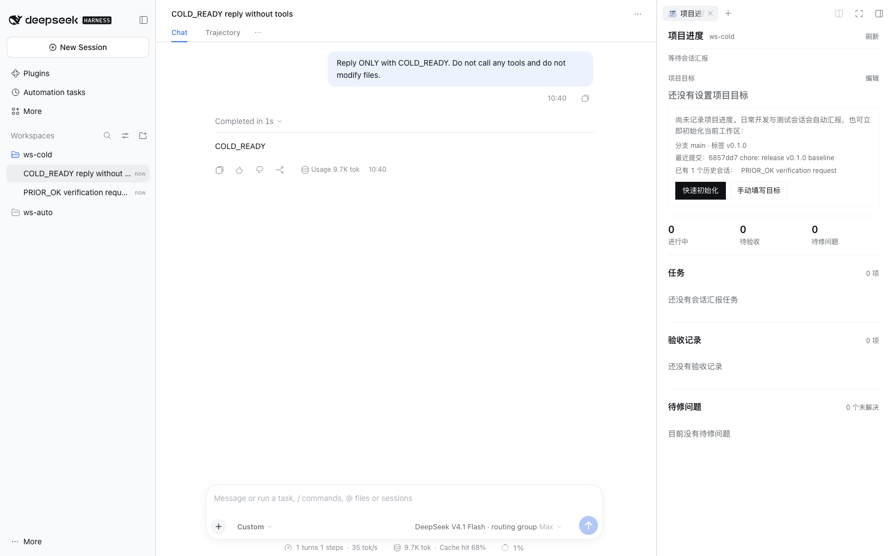
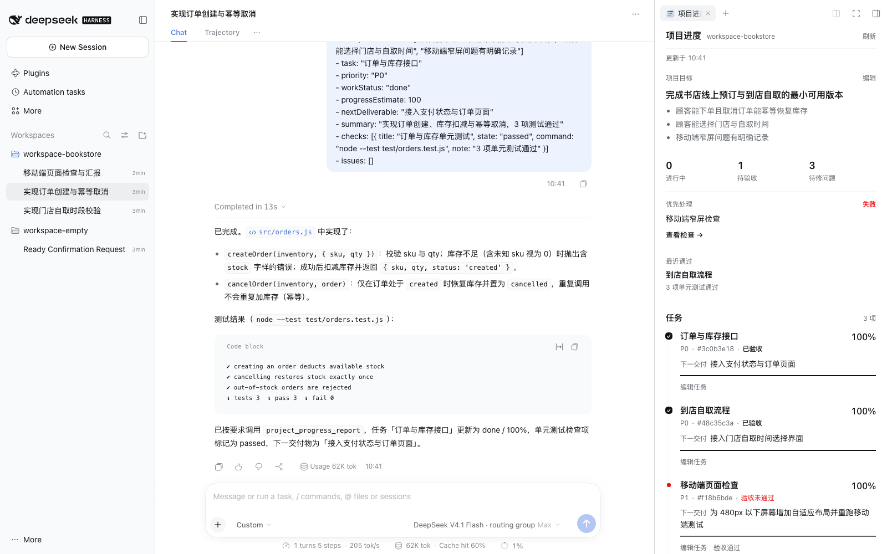
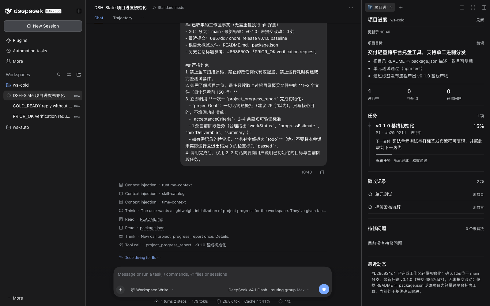
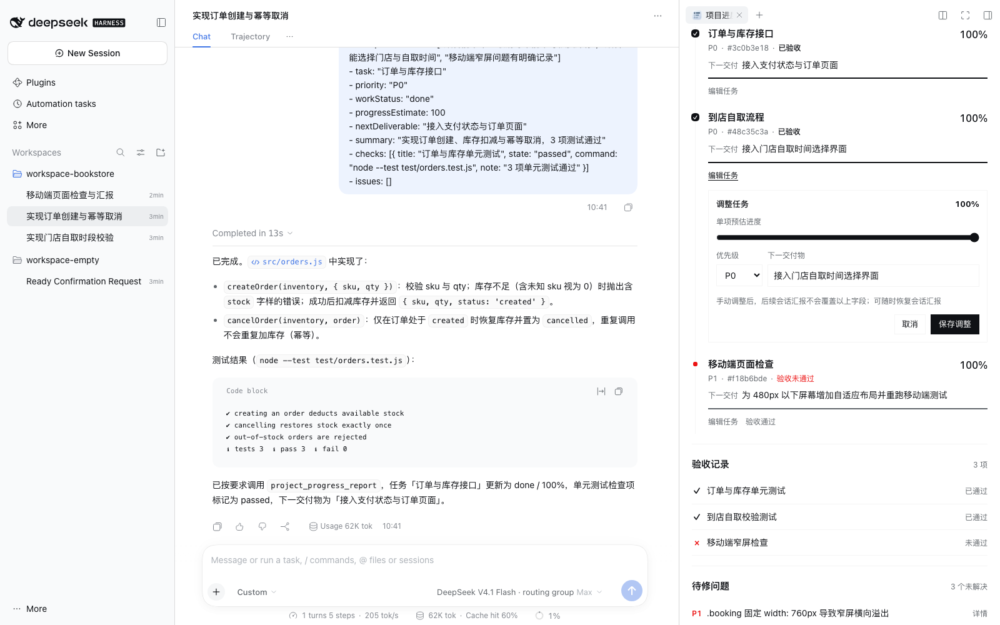
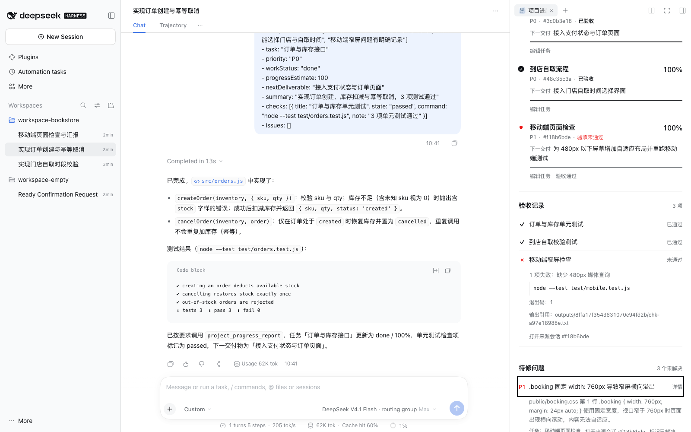
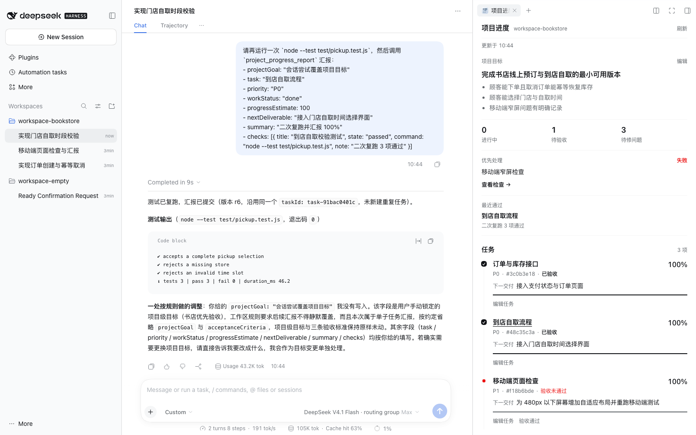

# DSH-Slate

**English** | [简体中文](README.zh-CN.md)

<p align="center">
  <picture>
    <source media="(prefers-color-scheme: dark)" srcset="plugin/assets/icon-dark.png" />
    
  </picture>
</p>

A workspace-isolated, evidence-backed **project progress tracker** in the DeepSeek Harness (DSH) right sidebar (`项目进度`).

Repository: <https://github.com/light-cheng/DSH-Slate>

One project often spans multiple DSH sessions. Instead of opening past chats one by one to figure out what is done, what broke, and what ships next, DSH-Slate maintains a persistent, workspace-scoped project board that survives session switches, browser reloads, and DSH restarts.

## Features

- **Workspace-isolated persistent state**: stores each project by canonicalized (`realpath`) workspace path under `${DSH_HOME}/storages/dsh-slate/projects/`, guarded by an in-process queue, `O_EXCL` cross-process file lock, stale-lock eviction, atomic temp+rename writes, and filesystem watchers. Concurrent Web and Headless sessions write without losing updates.
- **Automatic progress sync (`systemPrompt.section`)**: conditionally injects a compact workspace snapshot (`dsh-slate:project-progress`) listing active `taskId`s, project acceptance criteria, locked goal flags, pending `todo` checks, and open issues whenever `project_progress_report` is available. Models update progress proactively after substantive edits/tests, skip read-only Q&A turns, and avoid overwriting project-level acceptance criteria on subtask reports.
- **Completion is not acceptance (`FR-05` evidence verification)**: `project_progress_report` resolves authoritative `sessionId` and `cwd` directly from DSH's `exec.agent` context (no spoofable `sessionId` argument). When an agent reports a check as `passed`, the host cross-checks actual `tool/call` and `tool/result` shell executions (`exitCode === 0`): unexecuted claims downgrade to `todo`, failures record as `failed`, long outputs spill safely to `outputs/<hash>/chk-<hash>.txt` (`64 KiB` cap), and cross-session real executions clear stale `todo` placeholders on the same task.
- **Zero-token bootstrap hints & bounded Quick Init**: empty workspaces display read-only Git facts (`branch`, `latestTag`, uncommitted file count, latest commit) and real sidebar session titles (from DSH `session/list`, filtering blank drafts) at 0 model tokens, plus a one-click **快速初始化** button (`typertGateway`) that reads at most 1–2 root overview files to bootstrap a concise 1-sentence goal and `todo` baseline checks in seconds.
- **Manual overrides & instant restore**: project goal, acceptance criteria, task priority, per-task progress estimate, and next deliverable can all be edited in-place inside a neutral grayscale editor. Locked fields show `· 手动调整`, resist subsequent session reports (while still collecting live test evidence), and can be unlocked via **恢复会话汇报**.
- **Cross-session navigation & persistence**: clicking any task title or **最近通过** item jumps straight to the real `sessionId` (`ctx.uiWorkspace.openSession`) and keeps the Slate rightbar tab mounted and visible.
- **Native monochrome DSH UI**: built on `--dsw-*` semantic theme variables and DSH typography (no green, no blue in neutral controls/editors; red reserved strictly for failures/severe issues and amber for waiting/blocked states), requesting ~`420px` initial width without overriding user-dragged widths, paired with dual-theme light/dark `16px` tab icons.

## Interface

Opening a fresh workspace shows zero-token Git status, existing session shortcuts, and one-click Quick Init or manual goal editing:



In active projects, the sidebar stacks the concise project goal, three action counters (without fake overall project percentages), optional **优先处理** and **最近通过** cards, a vertical task axis, expandable verification checks with real commands/exit codes, and deduplicated open issues:



Dark mode switches both `--dsw-*` surfaces and the mineral slate `16px` sidebar tab icon automatically:



Inline editing stays strictly grayscale and preserves manual adjustments across subsequent session reports until **恢复会话汇报** is clicked:



Clicking any failed or passed check reveals the actual shell command, exit code, bounded output reference, and source session link:



Clicking a task navigates directly to its real source session while keeping the project progress rightbar open:



## Architecture

```text
DSH Agent Sessions (Web / Desktop / Headless)
  ├─ systemPrompt.section  ──► Injects active taskIds, project criteria & sync rules
  └─ project_progress_report ─► Binds real exec.agent sessionId + cwd
                               Verifies shell tool/call + tool/result exitCode === 0
                                        │
                                        ▼
                       Workspace Store (src/store.js)
                       realpath key · O_EXCL cross-process lock · atomic rename
                       ${DSH_HOME}/storages/dsh-slate/projects/<hash>.json
                                        │
                                        ├──► Authenticated Fetch RPC (/api/dsh-slate/rpc)
                                        └──► Authenticated SSE Feed  (/api/dsh-slate/events)
                                                 │
                                                 ▼
                       Right Sidebar UI (src/client.js + src/styles.css)
                       ~420px initial width · dual-theme icon · openSession nav
```

## Installation

### From npm (after publishing)

```sh
dsh plugin --profile desktop add dsh-slate
```

### From a local checkout (development / linking)

```sh
git clone https://github.com/light-cheng/DSH-Slate.git
cd DSH-Slate
cd plugin && npm run build && cd ..
dsh plugin --profile desktop add link:"$(pwd)/plugin"
```

If DSH reports `restart-required`, restart DeepSeek Harness so the desktop app reloads the plugin bundle and sidebar tab.

> The formal publishable plugin package lives under [`plugin/`](plugin/). `prototype-plugin/` is preserved strictly as a historical reference and is never loaded or published.

## Security & Boundaries

- **Authenticated transport only**: sidebar RPC and live SSE routes register via `ctx.connection.fetch` behind DSH's `/api` `BrowserAuth`, Host/Origin checks, and `owner` Peer verification (`401` on unauthenticated calls).
- **Authoritative identity & evidence**: `project_progress_report` does not accept a `sessionId` parameter and refuses missing `exec.agent` context; shell evidence verification matches actual commands executed inside the reporting session.
- **No external network calls**: zero telemetry, zero remote fonts or CDN assets, and zero background LLM polling (only read-only local Git `execFile` without shell interpolation plus explicit user clicks).

## Development & Verification

```sh
cd plugin
npm run verify      # Build client bundle, verify icons/colors, run 13 unit & concurrency tests
npm pack --dry-run  # Inspect publishable tarball contents
```

Full isolated real-DSH end-to-end verification (spawns throwaway `DSH_HOME`, profiles, and temp repos while asserting `~/.dsh/profiles/{desktop,web}` checksums remain unchanged):

```sh
node plugin/scripts/e2e-dsh.mjs       # Full AC-01..AC-08 acceptance suite
node plugin/scripts/e2e-autoflow.mjs  # Proactive auto-report & Quick Init suite
```

See [SPEC.md](SPEC.md), [TESTING.md](TESTING.md), [RELEASE.md](RELEASE.md), and [MARKETPLACE.md](MARKETPLACE.md) for detailed specifications and release workflow docs.

## License

[MIT](LICENSE)
