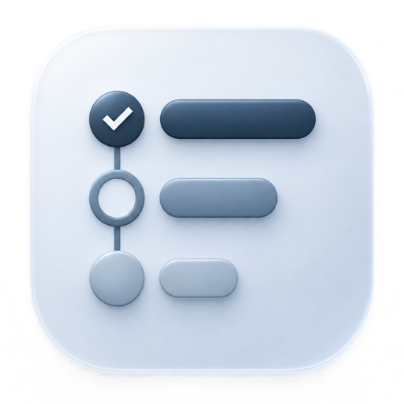
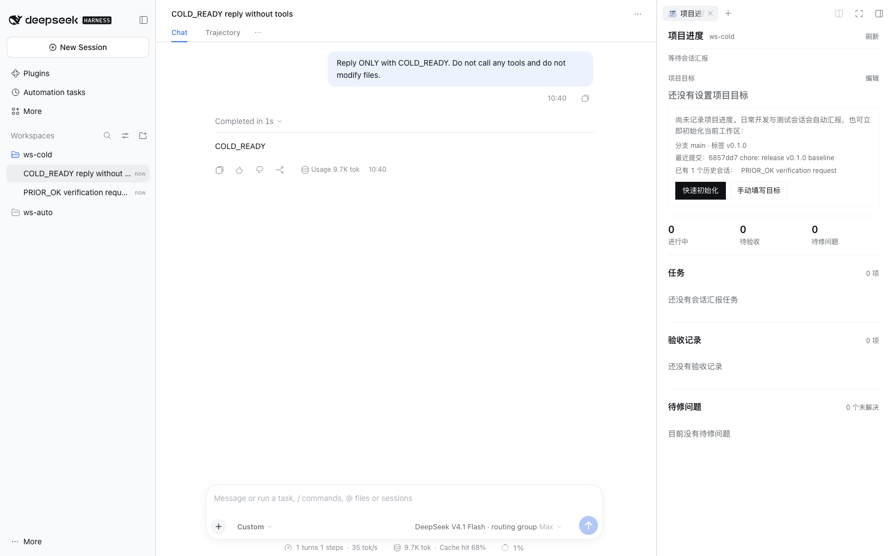
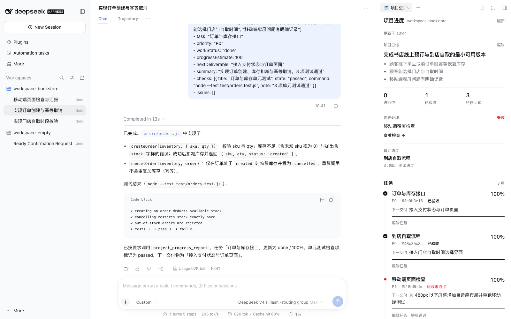
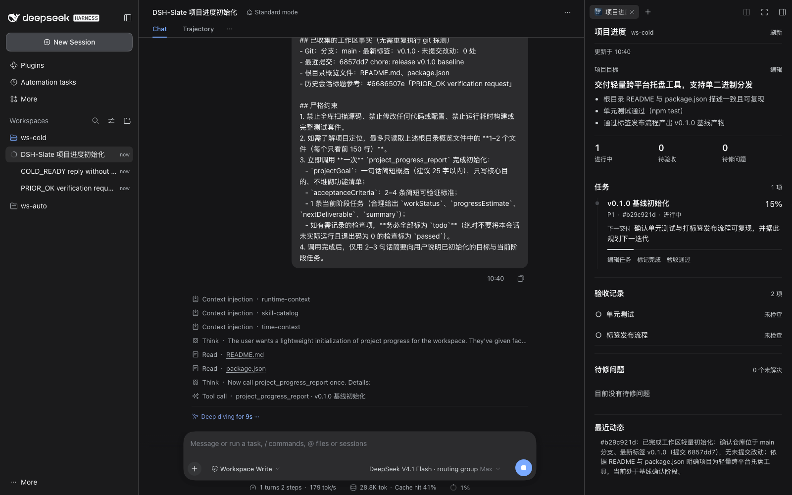
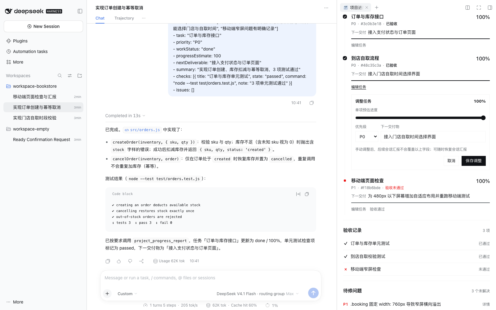
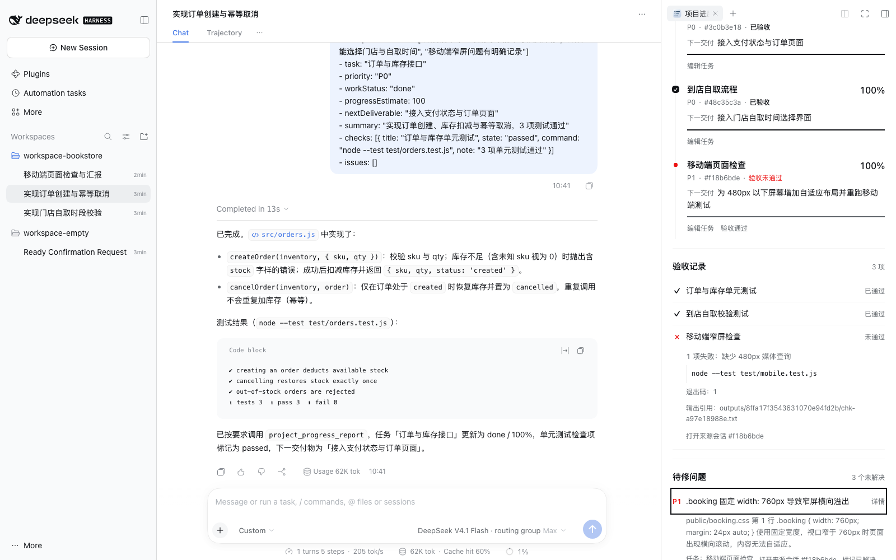
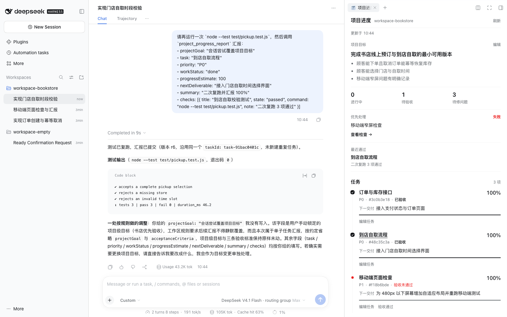

# DSH-Slate

[English](README.md) | **简体中文**

<p align="center">
  <picture>
    <source media="(prefers-color-scheme: dark)" srcset="plugin/assets/icon-dark.png" />
    
  </picture>
</p>

放在 DeepSeek Harness（DSH）右侧栏中的**工作区级「项目进度」共享视图插件**。

仓库：<https://github.com/light-cheng/DSH-Slate>

同一个项目往往会被拆成十几个甚至几十个 DSH 会话。以前想要搞清“谁做了什么、测试到底过没过、下一步交付什么、还有哪几个 bug 没修”，只能逐个点开历史会话翻记录；**DSH-Slate** 在右侧栏维护一份按工作区隔离、跨会话持久化、且经过真实命令证据核验的项目进度面板——切换会话、刷新页面或重启 DSH 后状态依然完整保留。

## 核心能力

- **工作区严格隔离与跨进程并发安全**：按规范化 `realpath` 工作区路径分库保存在 `${DSH_HOME}/storages/dsh-slate/projects/`，结合进程内串行队列、`O_EXCL` 跨进程文件锁、陈旧锁回收、原子临时文件替换写入与文件监听，Web 与多 Headless 会话并发写入不丢更新、不串项目。
- **日常会话主动同步（`systemPrompt.section`）**：当 `systemPrompt` 与汇报工具对当前会话可见时，条件注入精简的 `dsh-slate:project-progress` 上下文（含已有 `taskId`、项目级验收标准、目标手动锁定状态、待检查占位与开放问题）。助手完成实质代码改动或测试结果后会主动同步进度，纯只读问答不触发无效刷屏，子任务汇报也不覆盖整份项目级验收标准。
- **完成不等于验收通过（`FR-05` 真实证据核对）**：`project_progress_report` 直接从宿主 `exec.agent` 读取权威 `sessionId` 与 `cwd`（移除一切可伪造 `sessionId` 参数）。模型声称某项检查 `passed` 时，宿主会核对本会话真实的命令工具执行记录与退出码（兼容内置 `bash`/`pwsh`/`shell` 与 `dsh-ops` `ops_bash` 及 Windows 引号/反斜杠归一化匹配，必须 `exitCode === 0` 且无中断或拒绝标记）：未实际执行自动降级为 `todo`，实际报错/取消/受限改判 `failed`，长日志安全截断至 `64 KiB` 受控文件；同会话 TDD 由红转绿改名自动复用当前任务，后续实测通过还会自动清理同任务旧 `todo` 占位及已被替代的旧 `failed` 项。
- **0 token 工作区线索与一键「快速初始化」**：打开尚未记录进度的老项目时，不消耗任何模型 token 直接读取本地 Git 状态与全宽纵向可展开的真实历史会话列表（过滤已归档、空白草稿、失效及子代理会话）；点击 **「快速初始化」** 会通过 `typertGateway` 开启轻量会话，限制只读 1–2 个根目录概览文件，数秒内生成紧凑项目目标与 `todo` 检查基线。
- **手动调整保护、删除与一键恢复**：项目目标、验收标准、任务优先级、单项预估与下一交付物均可直接在侧栏编辑；修改字段显示 `· 手动调整`，后续会话汇报保留真实测试证据但不会静默覆盖手动值，随时可点 **「恢复会话汇报」** 解除锁定；过期或孤立任务可通过行内二次确认 **「删除任务」** 清理（绑定检查同步清理，关联问题保留为工作区级跟进）。
- **跨会话跳转保护与侧栏持久化**：点击任务标题、**「最近通过」** 或历史会话入口前会校验会话是否仍存在且未归档（多会话任务主会话失效时自动回退至同任务其他活跃会话）；会话已删除或已归档时不再误跳回空主界面，改为原地警告提示并标出 `会话已删除` / `会话已归档`，有效跳转后自动保持右侧「项目进度」标签打开。
- **原生 DSH 石墨单色视觉与双主题图标**：完整使用 `--dsw-*` 语义色阶与宿主字号，中性灰阶编辑区（无绿无蓝，红仅用于失败/严重问题、黄仅用于阻塞/等待），首次默认请求约 `420px` 宽度而不覆写用户手动拖动宽度，并随深/浅色主题自动切换 `16px` 矿石板岩 Tab 图标。

## 界面一览

打开尚未初始化的空白项目，零 token 展示本地 Git 线索、真实历史会话入口与一键快速初始化：



进入正常研发阶段后，侧栏自上而下呈现简洁的项目目标（`16px`）、顶部行动汇总（不展示虚假的项目总百分比）、优先处理与最近通过、纵向任务时间轴、真实命令验收记录及待修问题：



深色模式下 `--dsw-*` 色板与右侧 Tab 的深色矿石板岩小图标自动联动切换：



编辑态保持全灰阶，手动锁定后抗拒后续汇报覆盖，随时可通过「恢复会话汇报」同步会话最新值：



点击展开验收记录与问题详情，直接核对实际执行的命令、退出码、受控输出路径与来源会话链接：



点击任务标题直接打开对应的真实来源会话，且右侧「项目进度」标签自动保持打开：



## 整体架构

```text
DSH 会话运行时（Web / Desktop / Headless）
  ├─ systemPrompt.section  ──► 动态注入已有 taskId、项目验收标准与触发规则
  └─ project_progress_report ─► 读取权威 exec.agent sessionId + cwd
                               核对本会话 shell tool/call + tool/result exitCode === 0
                                        │
                                        ▼
                       工作区隔离存储（src/store.js）
                       realpath 路径哈希 · O_EXCL 跨进程锁 · 原子写入
                       ${DSH_HOME}/storages/dsh-slate/projects/<hash>.json
                                        │
                                        ├──► 认证 RPC（/api/dsh-slate/rpc）
                                        └──► 认证 SSE（/api/dsh-slate/events）
                                                 │
                                                 ▼
                       右侧栏界面（src/client.js + src/styles.css）
                       约 420px 初始栏宽 · 双色 Tab 图标 · 真实会话跳转
```

## 安装方式

### 从 npm 安装

```sh
dsh plugin --profile desktop add @lightcheng/dsh-slate
```

### 从本地源码链接安装（开发 / 源码试用）

```sh
git clone https://github.com/light-cheng/DSH-Slate.git
cd DSH-Slate
cd plugin && npm run build && cd ..
dsh plugin --profile desktop add link:"$(pwd)/plugin"
```

安装完成后如提示 `restart-required`，重启 DeepSeek Harness 即可在任意工作区右侧栏展开「项目进度」。

> 正式可发布插件代码与产物位于 [`plugin/`](plugin/) 目录；`prototype-plugin/` 仅作早期原型档案保留，不参与加载与发布。

## 安全与边界

- **严格认证通信**：侧栏所有写操作与 SSE 推送通过 `ctx.connection.fetch` 挂载在 DSH `/api` 入口之后，复用宿主 `BrowserAuth`、Host/Origin 校验与 `owner` Peer 鉴权（未认证请求返回 HTTP `401`）。
- **不可伪造上下文**：工具不暴露 `sessionId` 参数且禁止脱离 `exec.agent` 调用；检查证据只认本会话实际记录的命令行运行结果。
- **零外部外呼**：不收集遥测、不加载远程 CDN 资源，也绝不在后台偷偷发起模型请求（Git 探测仅使用无 shell 拼接的 `execFile` 只读命令）。

## 开发与验证

```sh
cd plugin
npm run verify      # 编译 lib/client.js，校验图标/配色/manifest，并运行全部 18 项单元与并发测试
npm pack --dry-run  # 预演检查最终 npm 发布包内容
```

隔离真实 DSH 端到端回归（新建临时 `DSH_HOME`、Profile 与测试项目，全程零修改现有 `~/.dsh/profiles/{desktop,web}`）：

```sh
node plugin/scripts/e2e-dsh.mjs       # 完整 AC-01..AC-08 端到端验收
node plugin/scripts/e2e-autoflow.mjs  # 主动汇报与一键快速初始化验收
```

更多细节请参阅 [SPEC.md](SPEC.md)、[TESTING.md](TESTING.md)、[RELEASE.md](RELEASE.md) 与 [MARKETPLACE.md](MARKETPLACE.md)。

## 开源许可

[MIT](LICENSE)
