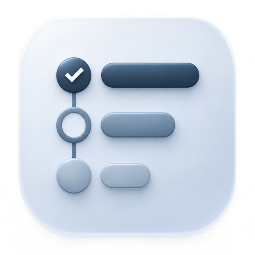
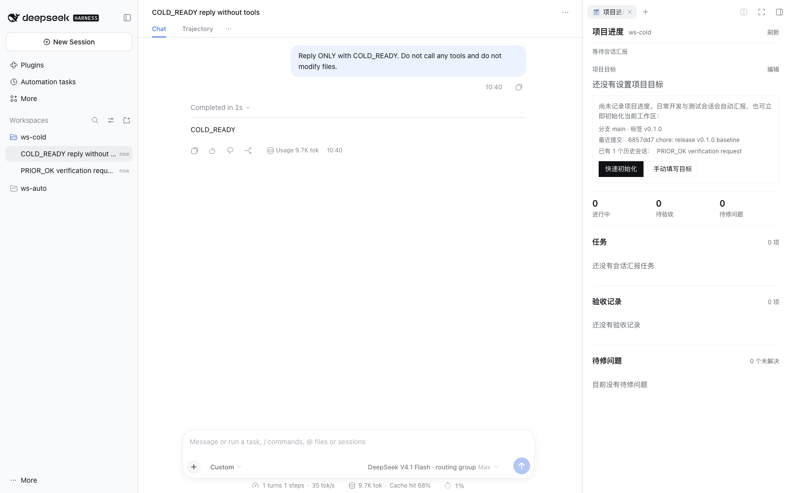
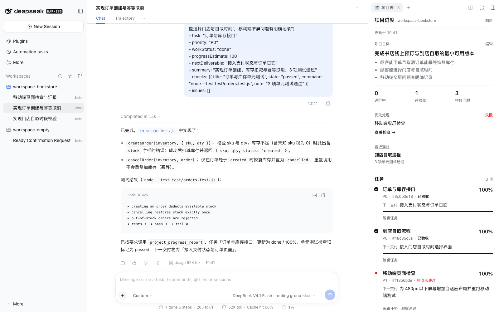
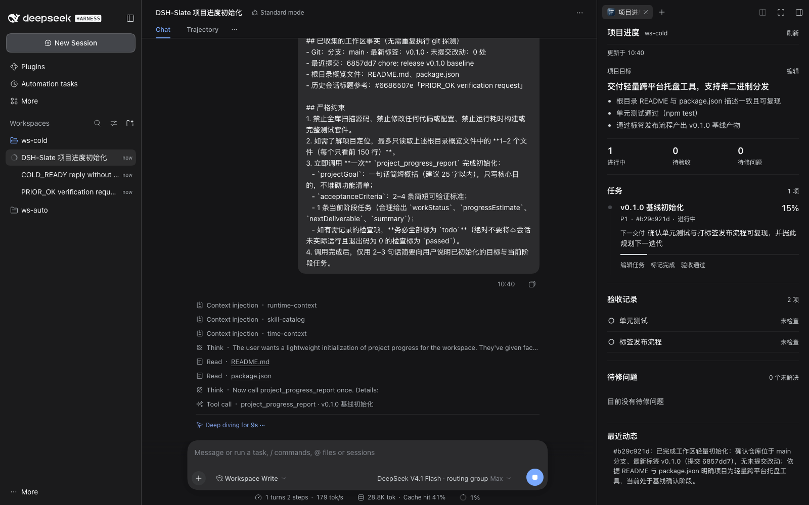
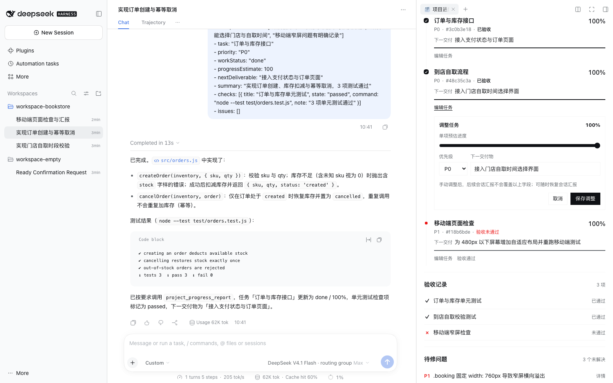
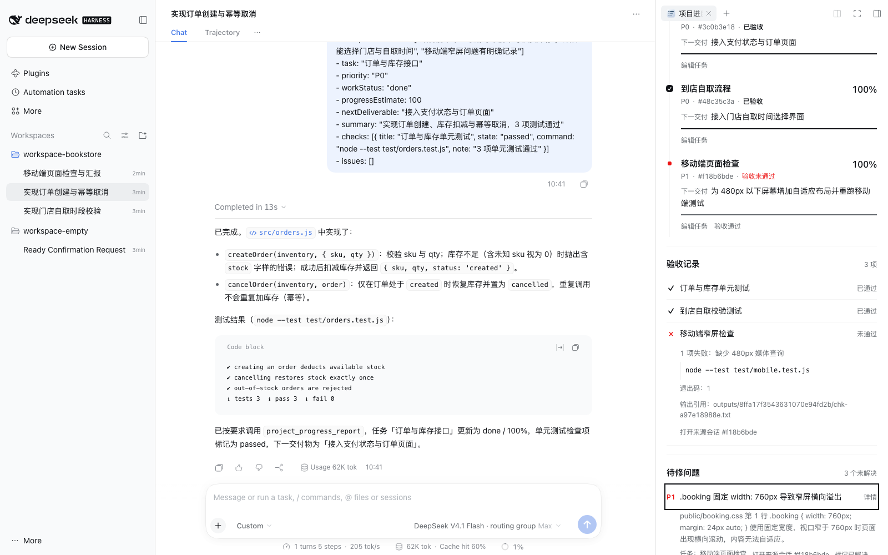
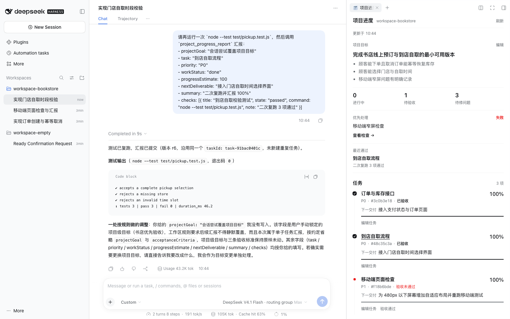

# DSH-Slate

**English** | [简体中文](https://github.com/light-cheng/DSH-Slate/blob/main/README.zh-CN.md)

<p align="center">
  <picture>
    <source media="(prefers-color-scheme: dark)" srcset="https://raw.githubusercontent.com/light-cheng/DSH-Slate/main/plugin/assets/icon-dark.png" />
    
  </picture>
</p>

A workspace-isolated, evidence-backed **project progress tracker** in the DeepSeek Harness (DSH) right sidebar (`项目进度`).

Repository: <https://github.com/light-cheng/DSH-Slate>

One project often spans multiple DSH sessions. Instead of opening past chats one by one to figure out what is done, what broke, and what ships next, DSH-Slate maintains a persistent, workspace-scoped project board that survives session switches, browser reloads, and DSH restarts.

## Features

- **Workspace-isolated persistent state**: stores each project by canonicalized (`realpath`) workspace path under `${DSH_HOME}/storages/dsh-slate/projects/`, guarded by an in-process queue, `O_EXCL` cross-process file lock, stale-lock eviction, atomic temp+rename writes, and filesystem watchers. Concurrent Web and Headless sessions write without losing updates.
- **Automatic progress sync (`systemPrompt.section`)**: conditionally injects a compact workspace snapshot (`dsh-slate:project-progress`) listing active `taskId`s, project acceptance criteria, locked goal flags, pending `todo` checks, unresolved checks, and open issues whenever `project_progress_report` is available. Models update progress proactively after substantive edits/tests, skip read-only Q&A turns, and avoid overwriting project-level acceptance criteria on subtask reports.
- **Completion is not acceptance (`FR-05` evidence verification)**: `project_progress_report` resolves authoritative `sessionId` and `cwd` directly from DSH's `exec.agent` context (no spoofable `sessionId` argument). When an agent reports a check as `passed`, the host cross-checks actual shell executions (`exitCode === 0`, covering built-in `bash`/`pwsh`/`shell` and `dsh-ops` `ops_bash` with normalized Windows path/quote matching): unexecuted claims downgrade to `todo`, failures/aborts/policy refusals record as `failed`, long outputs spill safely to `outputs/<hash>/chk-<hash>.txt` (`64 KiB` cap). Real follow-up executions clear stale `todo` placeholders and resolved `failed` checks on the same task, TDD red-to-green renames reuse the active unverified session task, and user-accepted tasks drop stale priority alerts while keeping historical check records honest.
- **Zero-token bootstrap hints & bounded Quick Init**: empty workspaces display read-only Git facts (`branch`, `latestTag`, uncommitted file count, latest commit) and an expandable full-width list of real historical sidebar sessions (filtering archived, blank, deleted, and subagent sessions) at 0 model tokens, plus a one-click **快速初始化** button (`typertGateway`) that reads at most 1–2 root overview files to bootstrap a concise 1-sentence goal and `todo` baseline checks in seconds.
- **Manual overrides, task deletion & instant restore**: project goal, acceptance criteria, task priority, per-task progress estimate, and next deliverable can all be edited in-place inside a neutral grayscale editor. Locked fields show `· 手动调整`, resist subsequent session reports (while still collecting live test evidence), and can be unlocked via **恢复会话汇报**. Obsolete or orphaned tasks can be removed via an inline two-step **删除任务** confirmation (preserving workspace issues).
- **Cross-session navigation guard & persistence**: clicking any historical session, task title, or **最近通过** item checks live session availability, falls back to another surviving session on multi-session tasks, avoids bouncing back to the DSH Home screen when a session is deleted or archived (showing an inline notice plus `会话已删除` / `会话已归档`), and keeps the Slate rightbar tab mounted across valid switches.
- **Native monochrome DSH UI & localized Plugin Manager entry**: built on `--dsw-*` semantic theme variables and DSH typography (no green, no blue in neutral controls/editors; red reserved strictly for failures/severe issues and amber for waiting/blocked states), requesting ~`420px` initial width without overriding user-dragged widths, paired with dual-theme light/dark `16px` tab icons and concise en/zh plugin detail pages.

## Interface













## Installation

### From npm

```sh
dsh plugin --profile desktop add @lightcheng/dsh-slate
```

### From a local checkout (development / linking)

```sh
dsh plugin --profile desktop add link:"$(pwd)"
```

If DSH reports `restart-required`, restart DeepSeek Harness to load the plugin bundle and open **项目进度** in the right sidebar.

## Architecture

```text
DSH Agent Sessions (Web / Desktop / Headless)
  ├─ systemPrompt.section  ──► Injects active taskIds, project criteria & sync rules
  └─ project_progress_report ─► Binds real exec.agent sessionId + cwd
                               Verifies shell tool/call + tool/result exitCode === 0
                                        │
                                        ▼
                       Workspace Store (src/store.js)
                       realpath key · O_EXCL cross-process lock · atomic rename
                                        │
                                        ├──► Authenticated Fetch RPC (/api/dsh-slate/rpc)
                                        └──► Authenticated SSE Feed  (/api/dsh-slate/events)
                                                 │
                                                 ▼
                       Right Sidebar UI (lib/client.js)
                       ~420px initial width · dual-theme icon · openSession nav
```

## Verification & Development

```sh
npm run build       # Bundle src/client.js + src/styles.css + embedded tab icons -> lib/client.js
npm run verify      # Build + verify manifest, icons, monochrome rules, and 18 unit/concurrency tests
npm pack --dry-run  # Preview tarball contents
```

See [RELEASE.md](https://github.com/light-cheng/DSH-Slate/blob/main/RELEASE.md) and [MARKETPLACE.md](https://github.com/light-cheng/DSH-Slate/blob/main/MARKETPLACE.md) for npm trusted publishing and marketplace submission details.

## License

[MIT](https://github.com/light-cheng/DSH-Slate/blob/main/LICENSE)
