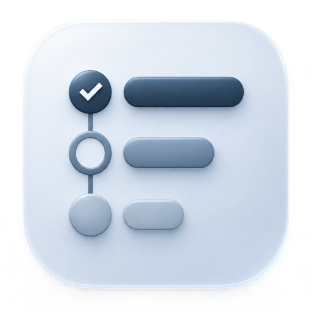
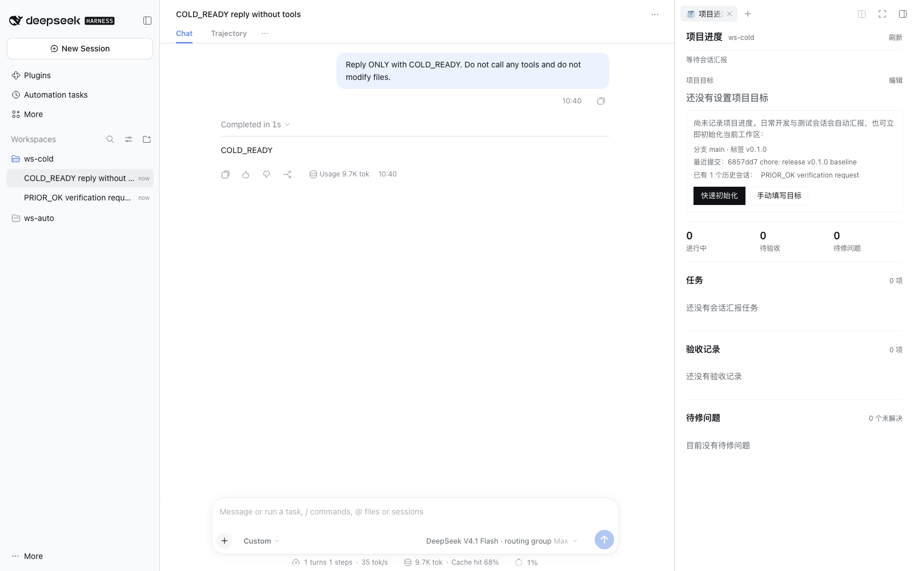
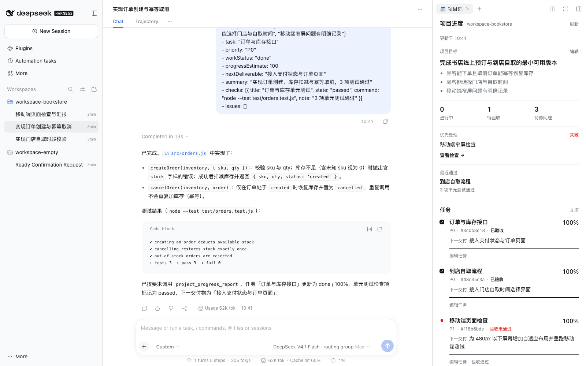
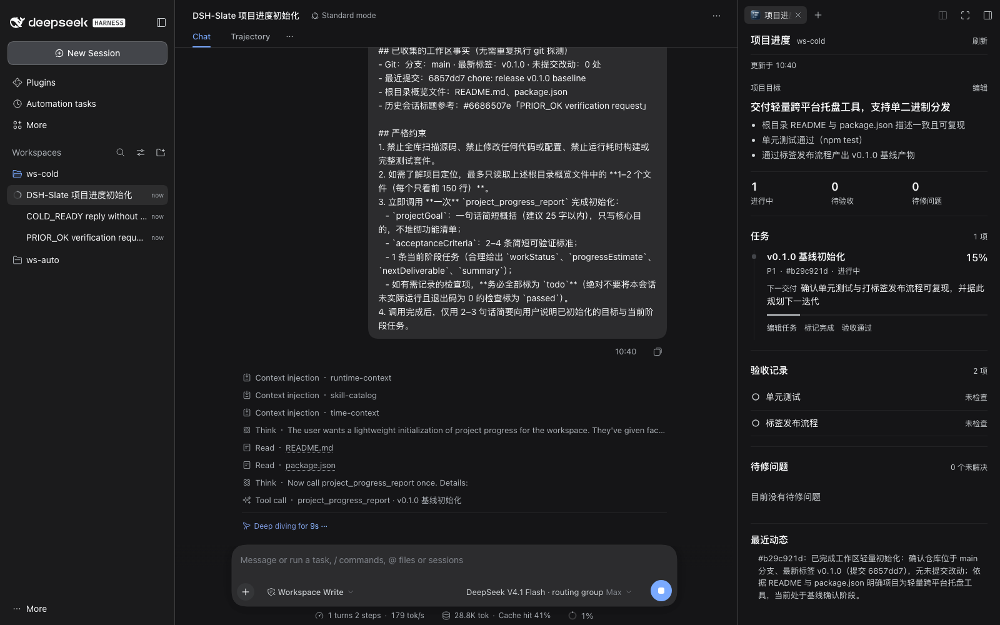
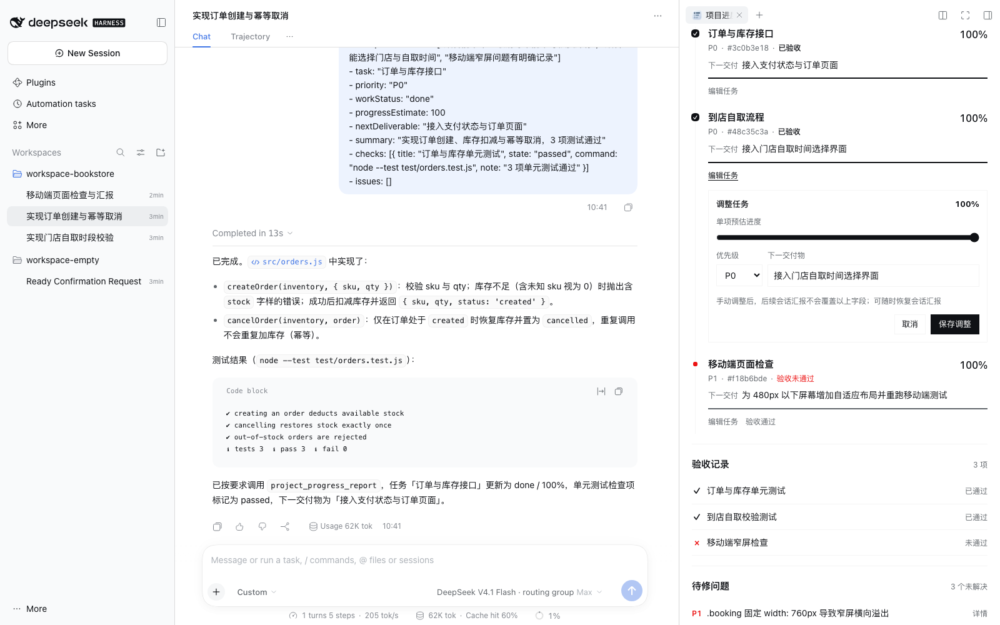
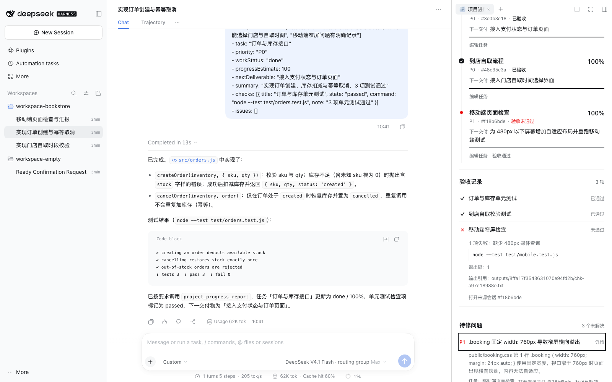
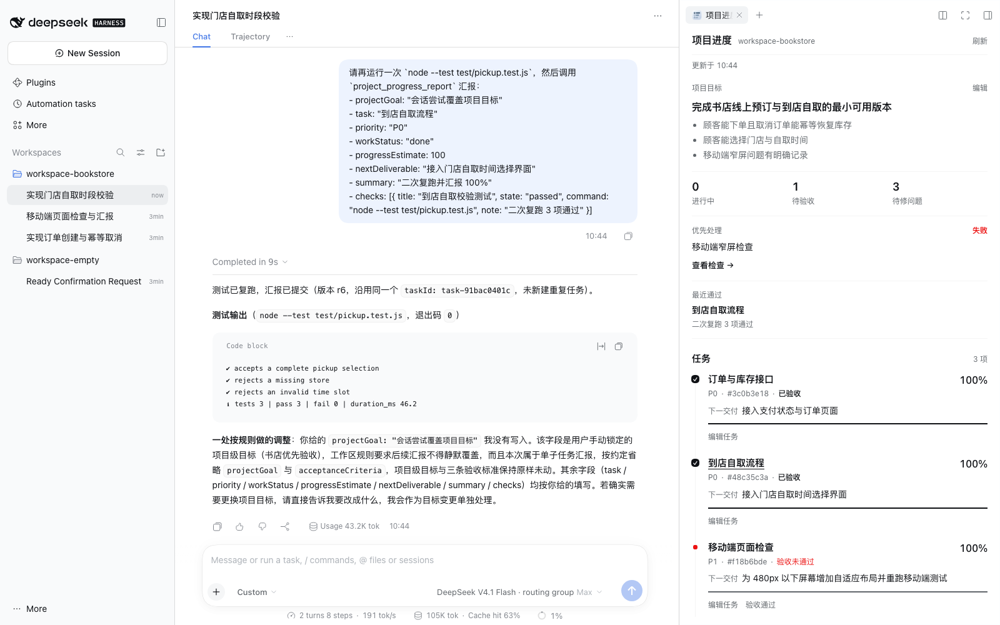

# DSH-Slate

[English](https://github.com/light-cheng/DSH-Slate/blob/main/README.md) | **简体中文**

<p align="center">
  <picture>
    <source media="(prefers-color-scheme: dark)" srcset="https://raw.githubusercontent.com/light-cheng/DSH-Slate/main/plugin/assets/icon-dark.png" />
    
  </picture>
</p>

放在 DeepSeek Harness（DSH）右侧栏中的**工作区级「项目进度」共享视图插件**。

仓库：<https://github.com/light-cheng/DSH-Slate>

## 核心能力

- **工作区严格隔离与跨进程并发安全**：按规范化 `realpath` 工作区路径分库保存在 `${DSH_HOME}/storages/dsh-slate/projects/`，配合进程内串行队列、`O_EXCL` 跨进程文件锁、陈旧锁回收与原子写入，多 Web / Headless 会话并发写入不丢更新、不串项目。
- **日常会话主动同步（`systemPrompt.section`）**：当 `systemPrompt` 与汇报工具对会话可见时，注入精简的 `dsh-slate:project-progress` 上下文（含已有 `taskId`、项目级验收标准、目标手动锁定状态、待检查占位、未通过检查与开放问题）。助手完成代码改动或测试结果后主动同步进度，纯只读问答不触发汇报，子任务也不覆盖项目级验收标准。
- **完成不等于验收通过（`FR-05` 真实证据核对）**：`project_progress_report` 直接从 `exec.agent` 获取权威 `sessionId` 与 `cwd`，禁止伪造身份入参；声称 `passed` 必须核对本会话真实的命令执行记录（兼容内置 `bash`/`pwsh`/`shell` 与 `dsh-ops` `ops_bash` 及 Windows 引号/反斜杠归一化匹配，必须 `exitCode === 0` 且无中断或拒绝标记），未运行降级为 `todo`、失败改判 `failed`。后续实测通过后自动清理同任务旧 `todo` 占位与被替代的旧 `failed` 检查，同会话 TDD 由红转绿改名不复制红灯任务，人工点击「验收通过」后清除顶部优先告警并诚实保留历史检查记录。
- **0 token 工作区线索与一键「快速初始化」**：空项目直接读取本地 Git 与全宽纵向可展开的真实历史会话列表（过滤已归档、空白草稿、失效及子代理会话），并支持通过受控单步指令一键初始化紧凑目标与检查基线。
- **手动覆盖保护、安全删除与跨会话守卫**：手动编辑目标、验收标准或任务字段后显示 `· 手动调整` 且抗拒后续汇报覆盖，随时可通过「恢复会话汇报」同步会话最新值；过期任务支持行内二次确认「删除任务」（保留工作区级问题）；跳转前校验会话存活与归档状态（多会话自动回退活跃会话），避免跳回空主界面并原地标注 `会话已删除` / `会话已归档`。
- **原生 DSH 石墨单色视觉与双语插件详情**：跟随 `--dsw-*` 变量、`16px` 紧凑目标标题、约 `420px` 初始栏宽不覆写拖动宽度，并随深/浅色模式自动切换 `16px` 矿石板岩 Tab 图标及中英双语插件页介绍。

## 界面一览













## 安装方式

### 从 npm 安装

```sh
dsh plugin --profile desktop add @lightcheng/dsh-slate
```

### 从本地目录链接安装

```sh
dsh plugin --profile desktop add link:"$(pwd)"
```

## 常用命令

```sh
npm run build       # 构建 lib/client.js
npm run verify      # 构建并运行全部校验、18 项单测与并发集成测试
npm pack --dry-run  # 检查发布包内容
```

## 开源许可

[MIT](https://github.com/light-cheng/DSH-Slate/blob/main/LICENSE)
